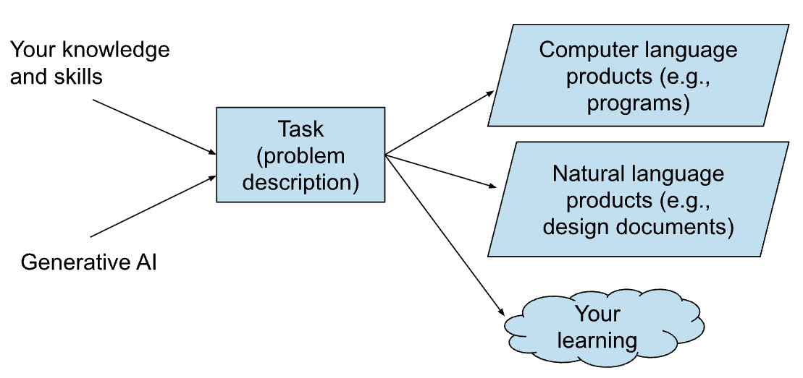
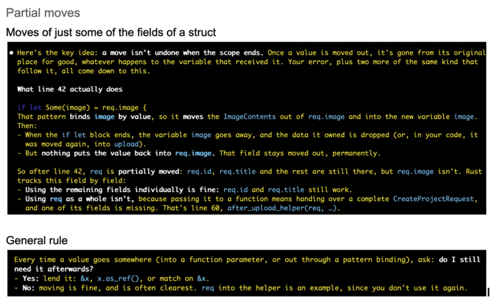

---
---

# Slow down and smell the learning: Keeping more of the knowledge in our own heads

Christopher G. Prince
 
11/23/26

# TL;DR
We have learning choices to make when using tools in software development. This is not new due to generative AI, but has become far more complex. We can delegate more and more work to these tools, but I believe we need to intentionally decide when to slow down and learn. These choices of when to learn are complex. Some people are focused on learning; others are not. Some job pressures demand more productivity. My goal here is not to lay down rules, it's to offer suggestions. Analogous to eating too much fast food, too much speed when using AI tools might not be good for you, as an individual human.

# Introduction
I’ve been using generative AI in the form of Claude and Claude Code for over a year now. I’m a software developer and initially this generative AI usage was at my former workplace (I’ll mostly just say “AI” for generative AI in the following). More recently it’s been on personal software development projects and in my search for a new job. What’s been on my mind most of all is learning, human learning. What impact does this technology have on my learning? And on the learning of others? Part of where I’m coming from is my history: I used to be an educator, teaching computer science. Part of this is also coming from something I enjoy in a workplace– mentoring others. How should I help others using this technology? How can I advise them in regards to learning?

This piece is mostly an essay, to write down my thoughts. But, my point of view is not new:
 
- “With how quick it is to get a feature out with AI I just see myself learning less and less…” ([Reddit](#references), 10/30/26).
 
- “How are you keeping your engineering instincts sharp?” ([LinkedIn](#references), 4/29/26)
 
- “Reliance on artificial-intelligence tools degrades the abilities of physicians and software engineers, studies show.” ([Nature](#references), 6/18/26)

Before I get started in earnest let’s acknowledge it’s a seriously amazing time we live in. Not only do we have rockets that return from space and land on their tails, but we also have computer systems that engage in an intelligent manner with us, in natural language. Wow. I didn’t think I’d live to see either.

When we do our work as software developers, we have choices we make in learning. And this is not new with the use of AI. An example. When I’m working on a bug, fixing a problem, sometimes I go fast and just work to solve the problem. My focus is on speed, and perhaps due to a deadline, I only prioritize getting the change into the code base and out the door, and thus I neglect learning. I don’t look around much in the codebase, perhaps ignoring opportunities to learn the code in the area where I’m making the change. Perhaps I don’t think about how this bug or fix relates to other work I’ve done, other bugs I’ve fixed. Because I’ve decided to work quickly, I learn less. At the end of the day, if I’ve worked on several bugs, it all becomes a bit of a blur. Good for productivity, good perhaps for my performance evaluation with my manager, less good for my long-term skills with the codebase. And perhaps less good for the health of the codebase. Maybe I could have noticed opportunities to resolve tech debt if I would have slowed down? Maybe I could have generalized this bug fix with others? Maybe if I would have learned the architecture of this part of the software better, I could make better strategic changes in the long term?

With AI, these learning choices become far more complex. AI, hands down, is the most complex tool we have at our disposal. While I love Docker, for example, its range of use is fairly narrow. Instead, what you can use AI for is really just up to your imagination, much the same way as “What program can I write?” used to be. When do we learn using this technology? My thesis is this: You can decide when to slow down, and take the time to learn. Just like before this technology, you decided: I’m going to work slowly on fixing a bug and look around the code, and learn some. Or not. I have a deadline, I’m going to work fast, and not prioritize my learning when fixing the bug.

I’m going to frame the overall situation in the following diagram:

You use your knowledge to come up with a task, a problem description. Or perhaps someone else gives you the task. You use AI, to some degree, to help solve that problem and perhaps to help frame the problem. You use your skills to help solve that problem. Perhaps writing some of the code, or the documentation that results. Perhaps guiding the AI using your knowledge. Perhaps reviewing the documents. And one of the products from this process is learning on your part. I align it with the other products, such as the documents coming out of the process, because to some degree your learning serves a similar goal. It will help you later. Others can read the documents, or the code, to help them understand. You have the code, the documents, and your learning to help you.

In the rest of this article, I’m going to cover several cases of where you can slow down and learn. I’ll start with the bug fixing case, and cover that in more detail.

# Slowing down and learning when fixing bugs
Bugs are the bread and butter of software engineering. You are often called on to fix bugs. And there are real decisions to be made in terms of learning. Do you take the time you need to learn, in addition to solving the problem? Or do you just go full throttle and fix the bug, perhaps due to time pressure?

Two separate factors can influence your decision about learning:
 
&nbsp;&nbsp;&nbsp; 1) perception of time pressure, and
 
&nbsp;&nbsp;&nbsp; 2) the availability of AI tooling. 
 
While there can be real time pressures and deadlines I often find myself succumbing just to a self-imposed pressure of productivity. And wanting to deal with the bug as quickly as possible. This though may not leave you in the best position to solve later bugs. If instead you learn all you can in solving a bug, when someone comes to you later with a similar bug you: 
 
&nbsp;&nbsp;&nbsp; a) may better remember that first bug, and
 
&nbsp;&nbsp;&nbsp; b) be better able to solve that new bug.
 
Companies often provide specific learning opportunities, such as courses or going to conferences. Why not treat a bug with similar learning respect? Treat a bug as an opportunity to learn about the software you are working with. As well as, of course, something that needs fixing.

Factor 2) above is a main topic here: The availability of AI tools. You have Claude Code at hand. You have a bug. Why not hit the nail with the hammer? Just give Claude the bug ticket, go get coffee, and presto you are done! Well, the same kind of reasoning as above can apply. If you are under real time pressure and the bug is relatively simple, using the AI tool may be the way to go. And I say “using” – and really mean just asking the AI system to do the full job. There are various prompting alternatives in the use of this tooling, if you want to learn along the way. Some examples:

1) “Here’s a bug (paste in details, or give ticket). Let's work together to diagnose this issue. Go slow. Don’t write any code yet. Realize that the presenting aspects of the bug may not be the actual problem.”

2) “Here’s a bug (paste in details, or give ticket). I’m new to the area of code that this issue is probably in. Let’s go slow. Teach me about this area of code.”

3) “Here’s a bug (paste in details, or give ticket). I’m trying to build up my skills on root-cause analysis. I usually find that finding a root cause makes for simpler bug fixes. Let’s go slow on this and work together to find the root cause. Help teach me more about root-cause analysis.”

You may have thought of similar ideas. I’m just trying to emphasize that we have large degrees of freedom with this tooling. Why not also have it serve you, the human person, to help you develop your skills?
Review what the AI has done (not just in PRs)
By review in this context, I don’t just mean PRs. I mean review the work, after a period of time. Effectively, after a series of PRs.

I just ran into this recently. Some context before I get started. In a personal project, for a woodworking app, I’m developing an iOS/MacOS client and a Rust server. I’m very well versed in iOS, so I’m getting Claude to help out heavily with the client. I feel confident in having Claude Code create initial drafts for a view on the screen, based on a design we (Claude and I) came up with. I can read the code and see if it’s what I want. That said, there is still space for additional review.

After getting Claude to do most of the work on the series of views and models, i.e., it was writing the code, I decided to fix an issue myself in that code. My purpose was to make sure I was still oriented to the code, and to do additional review of what Claude had done. This bug fixing work did have the intended effect of orienting me and helping me understand, but it also had an additional effect. I realized that Claude’s code structure, while not bad, wasn’t great either. In particular the organization of the code into files and those files into directories didn’t reflect the main views of the app. The organization of the code made it hard to find the main elements of the UI. So, in addition to fixing the bug, I did some restructuring. 

My point is that I slowed down, fixed an issue, and resolved another issue that I found. I learned some aspects about the code and improved the code.

# Slowing down to develop system architecture
I suspect many people are doing this, but it's new to me and I’m excited about it, and want to talk about it. This is less about learning, and more about structuring the overall manner in which a system is built. But, learning is related. Better organized code and systems improve your ability to learn (e.g., [Hermans, 2021](#references);  [Sweller, 1988](#references)). For example, if you have documentation about the architecture of the system, not only does that help your AI know what patterns to use, it helps humans learn about and understand the system.

In the same woodworking app project I mentioned above, part of my use of AI is in an architecture-first mode. Before I start working on code, I make the major decisions (with help from Claude). And document those decisions (in .md files in my project Docs folder). For example, I worked with Claude to decide what model/view architecture to use for the user interface. I decided to use [MVVM](https://en.wikipedia.org/wiki/Model%E2%80%93view%E2%80%93viewmodel) because I wasn’t well versed in this and wanted to learn. I got Claude to write up a doc on how to structure my views and models in this manner. The AI can use that doc to help structure the code when I say to it: “Write this particular view in an MVVM style based on the wireframe design we came with.” And I can use it later to refresh myself. And if others also end up working on the project, they can learn about the model/view architecture using this too.

So, the strategy could be phrased as: Slow down, organize, and develop architecture. Improve the system and help others understand and learn. Part of the understanding and learning are conventions, where there are just a handful of documented principles. And as a result the system and code should be more readable and learnable.

# Learning a new technology with the help of AI
When you are using a new programming language, or other new technology, you have a choice to make when using AI. Do you slow down and learn that new technology, or entirely trust that the AI will do what you want?

Using AI tools for tutoring with new technology is my current favorite use case for AI tools. With the woodworking app/server I mentioned, the server I’m developing is in the Rust language. This is my first significant project with Rust. A main goal for me is learning, to learn the Rust language, SDKs, and ecosystem. That’s a choice. Someone else could do the same project and decide they just want the server, and not the learning.

So, how do I use the tooling to learn? In a few ways. First, I don’t usually get the AI to write the code for me. I ask it to tutor me on parts of the language, and make notes in my learning documents about Rust (these are not documents that the AI writes). I write the code myself. When I get stuck and don’t understand something, I often go to Claude and ask it for help. But not to fix the code. I ask it to go slow, and teach me about the issue. Here’s an example:

## General context, what Claude Code says about its own memory:

In my memory for this project, on this Mac, outside the repo. Two entries:
- "Server goal: learning Rust": a main goal of the server work is for you to learn Rust, so writing more Rust yourself is a benefit, not a cost. It's why you chose your own users and sessions over Firebase Auth. It also says to still flag areas where a well-tested library is wiser than hand-rolling, like cryptography and JWT checking.
- "Teach slowly": for anything new, go one step at a time, let you write the code, and review what you wrote, unless you explicitly ask me to write it. For designs, lay out the options and let you decide.

## My specific prompt to Claude Code:

Don't change code. Talk. I'm getting a partial move issue on line 42 of the handler. But, that scope ends before the next req usage.

## Claude’s response:

There’s plenty of detail in there, but the point was that I had a particular problem in my Rust code, asked Claude Code about it, and to teach me, and it explained. And it helped me. I think I’ll remember the concept it told me about.

Similarly, I’ve also been using Claude Code for code reviews of my Rust code changes. And this has been very useful. I’ve been impressed by the quality of those reviews. And it helps me learn. Probably the next time I ask it for a code review, I’ll say “Give me a code review that helps me learn; don’t offer too much code to fix things.” But, even though I just said “Give me a code review on my changes” (to a particular place in the code) it was useful. It helped me learn. As an aside: I was also impressed by how receptive I was to its code review. Sometimes at work I get a code review that might be less than neutrally phrased and I get emotional. I felt none of that. The review was just about changes to be worked on.

# Conclusions
My purpose in this piece was to think about learning in the context of AI usage in software development. I have a bias in that I am a former educator, and have been heavily immersed in learning and teaching. That said, I definitely think we need this kind of AI technology or something similar, at least in software development. Basically, we need some help thinking about our software systems. We, as a community of software developers, have known for a long time that we have cognitively overreached ourselves with those systems. With large software systems no one person can understand it all. The systems are just too complex. Thus, we really do need help understanding, and thinking about these systems. Is generative AI “the” solution to this? Or will some other kind of technology be better? I don’t know.

In the end what you learn is up to you. If you take a course, what you learn varies strongly by how much you put into that course. If you use this AI technology, you have to decide what you want. Do you want to learn? What do you want to learn? When do you want to learn? Of course, the AI technology might be changed to better support that learning in some manner, for those that want to emphasize learning or in the tasks where they want to emphasize learning.

So, what do I advise to someone I’m mentoring? Like I said, what you learn is up to you. I think it’s the deciding that’s important. And strategizing about how to use the AI tools so as to fit your learning needs. These tools are big and broad. You can use them in many ways. If you are in a workplace, and feeling pressure to perform you need to balance that pressure with what you need personally. Companies sometimes encourage learning or offer employment benefits for continuing learning. These decisions about how to use the AI tooling are part of that. It’s analogous to eating fast food. Too much fast food is probably not good for your health. Too much use of the AI tooling that takes away from your personal learning, but allows you to move fast, is probably not good for you. I urge you to take the time, slow down, use the AI, but use it also to help you learn.

One more closing thought. We are delegating some of our work to the AI tools when we use this technology, and delegating work itself is far from new. Managers do this all the time. It's the who, or what we’re delegating to that’s new. And the myriad of details. If a technical manager wants to stay hands on, and competent they probably don’t delegate all of their work. They do code reviews. They write some code. They decide what fraction of their time should be spent on their own skills, their own technical contributions, and what time should be spent managing and delegating. Do the same with AI tools. Be its manager, but also be an individual contributor, writing some of the code, reviewing code. This is working out naturally for me on my wood working app project. I write nearly all of the Rust server code. The AI reviews it. The AI writes nearly all of the client code. I review it. Both sets of reviews result in changes.

# Acknowledgements
Thanks to Adam Wolf for his comments on this article.

# References

[Reddit] [https://www.reddit.com/r/SoftwareEngineerJobs/comments/1xjj6nx/lost_as_a_junior/](https://www.reddit.com/r/SoftwareEngineerJobs/comments/1xjj6nx/lost_as_a_junior/)

[LinkedIn] [https://www.linkedin.com/posts/ryandexterbrandt_the-thing-that-scares-me-about-ai-native-share-7455310694897545216-xWTm](https://www.linkedin.com/posts/ryandexterbrandt_the-thing-that-scares-me-about-ai-native-share-7455310694897545216-xWTm)

[Nature] [https://www.nature.com/articles/d41586-026-01947-1](https://www.nature.com/articles/d41586-026-01947-1)

Hermans, F. (2021). The Programmer's Brain: What Every Programmer Needs to Know About Cognition. Manning Publications. [https://www.manning.com/books/the-programmers-brain](https://www.manning.com/books/the-programmers-brain)

Sweller, J. (1988). Cognitive load during problem solving: Effects on learning. Cognitive Science, 12(2), 257–285. [https://onlinelibrary.wiley.com/doi/10.1207/s15516709cog1202_4](https://onlinelibrary.wiley.com/doi/10.1207/s15516709cog1202_4)
